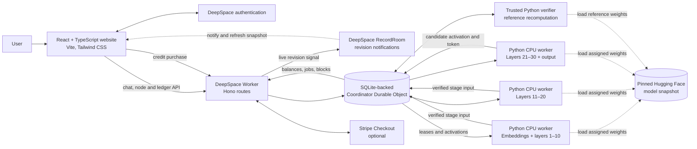

# NeuroGrid architecture

DeepSpace hosts the trusted control plane. Three volunteer PyTorch processes form the CPU inference pipeline. A fourth CPU process, controlled by the operator, independently verifies the outputs. The public website reads network projections and the credit ledger.

## Technology stack

| Area | Technology | Role |
| --- | --- | --- |
| Website | React 19, TypeScript, Tailwind CSS 4, Vite | Responsive pages for chat, network status, ledger, and node downloads |
| HTTP API | Hono on the DeepSpace Worker runtime | Authenticated app routes, coordinator API, and optional Stripe webhook |
| Platform services | DeepSpace SDK 0.44.2 | App hosting, authentication, Worker runtime, Durable Object bindings, and RecordRoom sync |
| Coordination and persistence | SQLite-backed Cloudflare Durable Object | Authoritative node registry, leases, jobs, balances, reservations, and ledger blocks |
| Inference clients | Python 3.12, PyTorch 2.7.1 CPU, Hugging Face Transformers 4.52.4 | Three partition workers and the trusted reference verifier |
| Desktop client | PySide6 6.9.1 | Optional desktop controls, tray integration, and resource settings for a node |
| Model | SmolLM2-135M-Instruct, pinned Hugging Face checkpoint | The same immutable model weights are used by workers and reference verifier |
| Credit integrity | SHA-256 hash-linked records in SQLite | Tamper-evident history under a trusted coordinator; not decentralized consensus |
| Optional payments | Stripe Checkout and signed webhooks | Moves existing treasury credits to a buyer after confirmed payment |

## Architecture diagram

### Component responsibilities

- **Website:** The browser presents the five product pages and sends authenticated chat, node-management, and ledger requests. It displays live status from coordinator snapshots; it does not decide worker identities, verify results, or write balances.
- **DeepSpace authentication and Worker:** DeepSpace authenticates users and hosts the application. The Hono routes validate the user's identity, enforce API boundaries, and forward authoritative work to the coordinator. Stripe is only involved when credit checkout is configured.
- **Coordinator Durable Object:** This is the trusted center of the MVP. Its SQLite transaction scope serializes jobs and keeps credit changes, reservations, and corresponding ledger blocks consistent. It chooses workers, issues leases, applies timeouts and failover, validates verifier results, and emits read-only revision updates.
- **Three Python workers:** Each separately installed CLI or desktop node polls for work and runs only its assigned model partition on CPU. The stages are sequential, so one token passes through all three workers before the next token can be selected.
- **Reference verifier:** An operator-managed Python process runs the same pinned checkpoint and independently recomputes each stage. It checks numerical agreement and the final greedy token before the coordinator accepts the stage. This is trusted reference checking, not proof that a particular physical machine did the work.
- **Model snapshot:** Workers and verifier fetch the same pinned Hugging Face files. Each process loads its assigned layer weights; the reference process has the weights needed to recompute all partitions.
- **RecordRoom and ledger:** RecordRoom carries revision signals so the browser knows to refresh authoritative state. The coordinator stores balances and SHA-256 linked blocks in SQLite. Hashes expose a changed history relative to a known chain head; they do not provide consensus or prevent the trusted coordinator from rewriting the whole chain.

## Inference

The checkpoint is Hugging Face's SmolLM2-135M-Instruct, revision `12fd25f77366fa6b3b4b768ec3050bf629380bac`, licensed Apache 2.0.

| Partition | Computation |
| --- | --- |
| Input | Token embeddings and layers 1–10 |
| Transform | Layers 11–20 |
| Output | Layers 21–30, final RMS normalization, tied vocabulary projection and greedy argmax |

The pinned safetensors file is shared in the machine's model cache. Each node loads only its partition's weights. The CPU implementation uses float32, eager causal attention, rotary position embeddings and no KV cache. Between partitions, the controller sends base64-encoded little-endian float32 activations. It limits prompts to 500 characters, total context to 128 tokens including the chat template and generation allowance, and generation to 24 tokens. Each prompt starts a fresh context.

The trusted reference applies the chat template. It recomputes every shard result and checks the shape, finite values and numerical agreement at relative tolerance 1e-4 and absolute tolerance 2e-4. The third partition's greedy token must match exactly. The controller forwards the canonical reference activation and repeats the cycle until EOS or the requested token limit.

## Coordination

Hono validates DeepSpace JWTs for account actions. An authenticated account creates scoped node keys. Automatic enrollment chooses the least represented partition. Each revocable key is hashed at rest and expires after 30 days. The verifier uses a separate operator-managed DeepSpace secret. Volunteers cannot access that interface.

A SQLite-backed Durable Object handles jobs, nodes, balances and blocks. It processes one request at a time. Nodes poll the coordinator, and availability expires 22 seconds after the last poll. For assignment, the coordinator uses workers that polled within eight seconds so an unresponsive worker cannot block a backup until the stage deadline. It prefers the lowest recent HTTPS round-trip times. It rotates by least recent assignment among workers within 25 ms of the fastest sample. When no eligible worker has a recent sample, it uses assignment history.

The desktop and CLI node echo a one-time challenge when a poll has no work, at most once every 15 seconds. The coordinator measures elapsed time from challenge issuance to the authenticated reply, smooths recent samples, and ignores samples older than one minute. Older clients continue to poll without probes. The measurement covers the worker-to-coordinator path. Model execution time and the user's browser connection are separate.

A lease applies to one node and stage and lasts 12 seconds. If a worker times out or returns an invalid result, the coordinator can route the same stage to a different worker. A waiting stage or verification step has a 12-second deadline, and the entire job has a 180-second limit. The Durable Object alarm expires leases and refunds timed-out jobs while browser tabs are closed.

The DeepSpace RecordRoom broadcasts a read-only revision signal. Browsers fetch the coordinator snapshot on changes and periodically if sync is interrupted. Private job history and balances are scoped to the authenticated user.

## Credits and ledger

Genesis puts 100,000 credits in the treasury. An account can receive a 100-credit grant, while the treasury has funds. The coordinator reserves 1 + 3 × maximum output tokens. A successful request pays one credit per verified shard step and one to the treasury. Unused reserve returns to the requester. An unsuccessful request receives the full reserve and earns zero rewards. Availability is tracked independently of payouts.

Each financial transition and corresponding block append happens in one synchronous SQLite transaction. User-scoped idempotency keys prevent repeated debits. Every block includes a canonical field sequence, the prior SHA-256 hash and pseudonymous transfer deltas. Settlement includes a digest of the verified steps. Replay checks the links and hashes, genesis supply, integer transfers, nonnegative balances and a single terminal event per reservation.

When Stripe Checkout is configured, visitors can quote orders of 100–10,000 whole credits at one US cent per credit. A signed-in buyer's order moves the requested treasury credits to checkout escrow before opening the hosted payment page. Stripe receives an idempotency key tied to the order. A signed paid event for the expected USD amount settles the order exactly once and appends a receipt digest. Confirmed expiration or payment failure releases the escrow. Credits are for NeuroGrid inference and all transitions preserve the original supply. The public ledger does not contain Stripe customer or card data.

## Trust and operation

Reference recomputation confirms output agreement. It duplicates inference arithmetic and cannot prove which physical computer performed the work. A known chain head is required to detect tampering by a coordinator that can rewrite its history. SQLite and access controls suffice under a single trusted operator. Independent validators with shared authority could justify a replicated ledger in a future version.

Volunteers receive model input tokens or internal activations and may be able to infer prompt contents. Keep sensitive data out of prompts. Private chat history persists in SQLite. The coordinator clears raw activations when a job ends.

The hosted control plane needs a connected verifier and at least one available volunteer for each partition. Generating full-context activations per token limits throughput. Test processes on a single host demonstrate separate protocol clients and do not establish independent physical machines.

[Pinned model configuration](https://huggingface.co/HuggingFaceTB/SmolLM2-135M-Instruct/blob/12fd25f77366fa6b3b4b768ec3050bf629380bac/config.json) · [DeepSpace documentation](https://docs.deep.space/)
