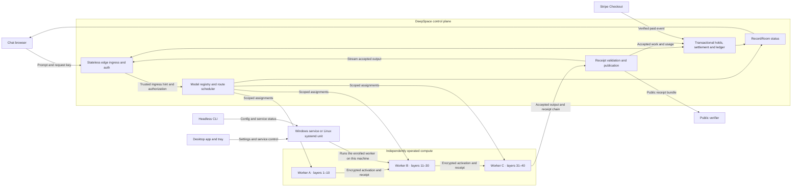
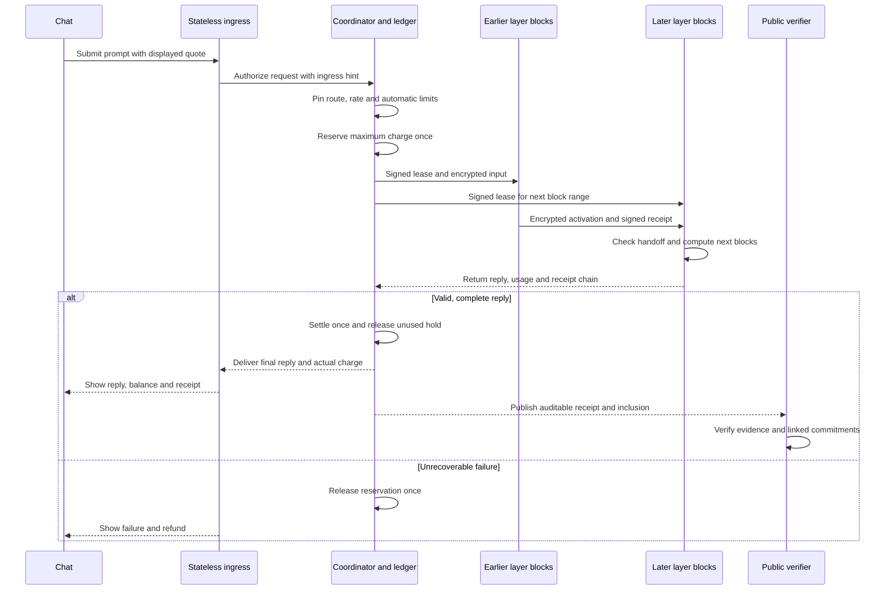

# NeuroGrid architecture

The Granite candidate runs four BF16 CPU partitions with reference recomputation. The diagrams describe the target distributed architecture. The [CPU proof pilot](#cpu-proof-of-inference-pilot) implements an independent verifier for a small model.


## Target architecture

NeuroGrid routes inference requests to independently operated compute workers. DeepSpace handles web hosting, authentication, read-only status updates, and the stateless request ingress. The coordinator manages assignments and the credit ledger. Workers produce the inference result and the evidence attached to it. An independent verifier can validate the evidence without running inference.



The three compute boxes illustrate one route. A node can host zero or more adjoining blocks within its resources. A route can use one machine or several, and a different job can use a different route. The contributor apps shown manage one example machine. The compute and control plane paths have separate failure and scaling concerns.



## Model and execution

- **Paid default.** The target is pinned IBM Granite 4.2 8B, a dense Granite decoder with 40 layers, hidden width 4,096, and a 100,352-token vocabulary. Package four 10-layer blocks. Put the embeddings in the first block and the final normalization and vocabulary head in the last. Pin artifact hashes, tokenizer and chat template, numerical format, and sampling policy in the manifest. Each worker loads the ranges it advertises. Benchmark memory, quality, and latency before enabling a quantized variant.
- **TwIL-8B research.** TwIL-8B uses the same base architecture and has its own weights and model manifest. Its published license limits use to non-commercial research and education. Paid deployment requires commercial permission. The IBM Granite base is Apache-2.0. [Granite model card](https://huggingface.co/ibm-granite/granite-4.2-8b) · [Granite configuration](https://huggingface.co/ibm-granite/granite-4.2-8b/blob/main/config.json) · [TwIL model card](https://huggingface.co/webAI-Official/TwIL-8B) · [TwIL license](https://huggingface.co/webAI-Official/TwIL-8B/blob/main/LICENSE.md)
- **Inference.** Tokenize with the selected model’s chat template. The server picks automatic context and output limits. The first pass processes the prompt and initializes the KV cache. Later passes run the next token against cache state retained on the assigned workers. Send authenticated, encrypted binary activations stage to stage. A trusted regional relay can carry encrypted traffic where direct connectivity is unavailable. The coordinator accepts worker output with valid evidence. The operator’s current full reference verifier belongs in offline regression testing.
- **Placement and concurrency.** Admit many independent requests subject to bounded queues and worker capacity. Use a trusted ingress hint such as `request.cf.colo` to shortlist regional workers. Rank complete routes by fresh ingress-to-worker and peer link measurements, warm blocks, queue delay, compute, and failure history. The colo identifies the incoming data center. Treat it as a hint and measure actual serving paths. Co-locate contiguous blocks or select a whole-model worker when that is faster. Keep leases and cache affinity stable until failure or completion. [Cloudflare request metadata](https://developers.cloudflare.com/workers/runtime-apis/request/) · [Petals research](https://arxiv.org/abs/2312.08361)

## Verification and trust

The hardware-backed design uses **remote attestation**. The signed worker runtime checks the pinned model and signs receipts that bind the job, assignment, block range, sequence, metered work, and input/output and cache state commitments. The next stage checks the handoff before using it. Any observer can check the published evidence, receipt chain, and inclusion with a public verifier and no model execution. A requester can match their reply to its receipt. Public receipts expose commitments and exclude prompt text, activation data, and replies. This guarantee relies on the approved runtime and hardware root of trust. [IETF remote attestation architecture](https://www.rfc-editor.org/rfc/rfc9334) · [NVIDIA attestation](https://docs.nvidia.com/confidential-computing/containers/dev/attestation)

### CPU proof of inference pilot

The pilot in [compute/proofs](compute/proofs) uses Kimchi/Pickles zero-knowledge proofs on ordinary CPUs. A fixed circuit defines a deterministic two-stage integer attention model with a four-token vocabulary, one cached key/value pair per stage and two generated tokens. The pinned verification key commits to the model weights, attention rules and greedy decoding, including the order used for ties. [Kimchi specification](https://o1-labs.github.io/proof-systems/specs/kimchi/) · [Circuit source](compute/proofs/circuit.ts)

The requester issues an assignment with the input commitment, job ID, epoch and one lease per stage and token position. Each proof checks the stage's numerical operations and binds these assignment fields to four salted Poseidon commitments for the input, output and before/after cache. The verifier uses an independently obtained assignment to check all four proofs and the activation, autoregressive token and cache links. The private input, activations, cache and output tokens are absent from the public receipt. A requester can privately open both reply token commitments. The verifier needs the public artifacts and pinned key and performs no model execution. [Receipt verifier](compute/proofs/receipt.ts)

Run from the repository root with Node 24 after `npm ci`. Use unused file names or pass paths in a scratch directory. Keep `input-opening.json` and `reply.json` private.

```sh
npm run proof:pilot -- issue 2 assignment.json input-opening.json
npm run proof:pilot -- prove assignment.json input-opening.json receipt.json reply.json
npm run proof:pilot -- verify assignment.json receipt.json
npm run proof:pilot -- verify assignment.json receipt.json reply.json
npm run test:proof
```

On Windows 11 with a Ryzen 5 5600X and Node 24.22.3, the seven proof tests passed. One run produced a 121 kB receipt in 60.5 seconds and verified it in 6.5 seconds in a separate process with only the verifier, pinned key, public assignment and receipt. The tests rejected an invalid model label, a forged activation, altered cache or output commitments, a substituted proof and replay under a different job, epoch or lease. Linux execution and full Granite proof latency remain unverified.

The pilot runs outside the coordinator and ledger. Granite's current BF16 path still uses reference verification. Moving paid Granite jobs to proofs requires a pinned provable Granite numerical format and full circuit coverage, an audit of the constraints, measured proving and verification costs, and an end-to-end test that verifies before settling the credit hold. The coordinator must separately check worker identity, lease freshness and idempotent settlement. [zkLLM research](https://arxiv.org/abs/2404.16109)

### Granite checkpoint projection benchmark

The [Granite projection verifier](compute/proofs/granite-receipt.ts) checks a proof for one output row of the first layer's query projection. The exporter reads the pinned checkpoint using the existing tokenizer and partition loader. It extracts one normalized token activation and the 4,096 learned weights in the row. It rounds weights to signed integers at scale 4,096 and activations at scale 64. The circuit checks the exact integer dot product, binds the input to a salted commitment and binds the result to the request and model revision. The verifier uses the pinned circuit key, public assignment and receipt. This arithmetic benchmark covers one projected value and the chat release requires the full inference proof.

Run the exporter with the installed Python dependencies and `compute` on `PYTHONPATH`. Use a scratch directory for the generated artifacts. The sample and opening contain private witness material. The public receipt includes the projected integer.

```sh
python compute/proofs/export_granite_projection.py --checkpoint /path/to/pinned/granite --position 6 --output sample.json
npm run proof:pilot -- granite-issue sample.json assignment.json opening.json
npm run proof:pilot -- granite-prove sample.json assignment.json opening.json receipt.json
npm run proof:pilot -- granite-verify assignment.json receipt.json
```

Set `NEUROGRID_PROJECTION_SAMPLE` to the exported sample and run `npm run test:granite-proof` to check the independent verifier, modified results, replay, and changed weights and activation. `granite-export-key` regenerates the circuit key from a sample exported from the manifest-verified checkpoint.

All three benchmark tests passed on Windows 11 with a Ryzen 5 5600X and Node 24.22.3 using Granite revision `a7042144125ce5ae64f89610e8289647fc000b9a`. The prover produced a 29.9 kB receipt in 30.1 seconds after 4.0 seconds of cached key setup. A separate process checked it in 4.2 seconds using the key, assignment and receipt. Hosted chat remains paused pending full Granite proofs.

### Full-layer prover compatibility

[The decode compatibility check](compute/proofs/check_granite_decode_backend.py) exports a full first-layer decode step from the pinned checkpoint. It compares the decoder's hidden-state output and updated key and value tensors across PyTorch and ONNX Runtime on CPU, using both the original sample and changed inputs. The export uses FP32 and the existing eager attention implementation to express grouped-query attention as portable ONNX operators. A candidate proof runtime still needs a defined numerical format and end-to-end answer quality checks.

Run with `compute` on `PYTHONPATH`, the existing Python 3.12 node dependencies, `onnx==1.20.1` and `onnxruntime==1.24.4`. Add `ezkl==23.0.5` for the optional compiler check. The output directory is a new scratch directory for the exported graph and private sample input.

```sh
python compute/proofs/check_granite_decode_backend.py --checkpoint /path/to/pinned/granite --output /path/to/scratch/decode-check --position 6 --ezkl-columns 2
```

Use `--ezkl-columns 8 --ezkl-witness-scale 14` to calibrate, compile and compare the witness's output and cache against the CPU layer. The check stops if calibration or parity fails. This diagnostic uses a pinned checkpoint and one fixed token position.

On the Windows Ryzen host, the CPU export parity check passed on the pinned Granite 4.2 8B checkpoint. EZKL's two-column estimate for one decoder layer at one position was 102,039,720 rows and 204,079,466 assignments. This requires at least a 2²⁷-row domain. HEAD requests to the EZKL parameter mirror returned HTTP 200 for the 2²⁶-row file and HTTP 404 for the required 2²⁷-row file. [EZKL parameter source](https://github.com/zkonduit/ezkl/blob/v23.0.5/src/pfsys/srs.rs)

An eight-column layout with safe checks reduced the domain to 2²⁵ rows and still required 205,922,040 assignments. The compiler accepted that layout in 32.5 seconds and wrote a 6.38 GB circuit for this single decode layer. The published setup file for that domain reports a 4.29 GB download. Witness generation took 171.6 seconds. At the tested fixed-point scales, the maximum absolute differences from the FP32 export were 0.8263 for the layer output, 0.4394 for the updated key and 0.4266 for the updated value. All three failed the benchmark parity tolerance. The test stopped before key setup and proof generation on this configuration.

At fixed-point scale 14, the two-limb layout exceeded the decomposition range during calibration. With three limbs, the baseline eight-column layout estimated 25,816,921 rows and 206,535,440 assignments in 153.3 seconds on the same Windows host. The calibrated candidate failed because its extended domain was too large for the quotient polynomial at the reported `logrows=21`. Neither scale-14 run produced a witness or proof.

The zkTransformer paper artifact uses synthetic weights for its LLaMA shape benchmarks. A Granite adapter would need checkpoint loading and Granite's grouped attention, attention scaling and rotary configuration. The Windows compatibility build progressed past dependency resolution after pinning `kstring` to 2.0.2. Windows Application Control then blocked a Cargo build helper with OS error 4551. [zkTransformer artifact at the tested revision](https://github.com/uiuc-kang-lab/zkTransformer/tree/55344d7c37232b4dbe8aa479e139967230d8449b)

#### Granite layer 0 proof audit

The benchmark uses layer 0 at decode position 6 of the manifest-verified Granite 4.2 8B checkpoint on Windows 11, a Ryzen 5 5600X and 32 GiB of installed RAM. Its statement covers the residual output and updated key and value cache given one activation and the incoming cache. FP32 PyTorch and ONNX Runtime agreement tests the graph. A proof from this benchmark would attest to the compiler's fixed-point circuit. Matching one FP32 example within tolerance would leave exact BF16 serving equivalence and other positions untested.

| Layer operation | Measured evidence and failure classification |
| --- | --- |
| Input and post-attention RMSNorm | Both produce witnesses. At Q14, maximum absolute differences were 0.00124 and 0.00266. Both failed the elementwise parity gate. Both passed in isolation at Q16 and Q18, which confirms a fixed-point precision limitation at Q14. |
| Q, K, V and attention output projections | The existing Kimchi proof covers one Q output lane, a 4,096-term dot product using checkpoint coefficients. The four full projections had Q7 witness maximum errors of 0.559, 0.447, 0.427 and 0.379. A separate rounding experiment recovered similar errors. Previously nonzero values rounded to zero represented 22–36% of all entries in the Q/K/V matrices and 96% of all entries in the output projection. |
| Rotary encoding, cache concatenation and residuals | Each generated a Q14 witness and passed the isolated FP32 parity check. Cache concatenation includes the incoming cache and newly computed vectors. These checks measured witnesses. |
| Grouped attention, score scaling and softmax | The Q14 score dot products and standalone softmax passed parity. The combined graph failed calibration. EZKL represented Granite's `1/128` multiplication as an identity with seven more fractional bits, which made the observed exponential lookup range 128 times wider. The resulting lookup packing and quotient domain exceeded backend limits. Expressing the operation as division by 128 retained the failure. Explicit row-max subtraction before softmax triggered a rebase. The grouped-attention lookup minimum fell to −973,908 at Q14 and a witness was generated. It still differed by up to 0.000442 and failed parity. The centered Q16 and Q18 fragments passed, with maximum errors of 0.000175 and 0.000024. [EZKL lowering](https://github.com/zkonduit/ezkl/blob/v23.0.5/src/graph/utilities.rs) · [Domain selection](https://github.com/zkonduit/ezkl/blob/v23.0.5/src/graph/mod.rs) |
| MLP gate, up and down projections | All generated Q7 witnesses. Maximum absolute errors were 0.589, 0.667 and 0.586. Their weight quantization dominates that error in the independent dot-product check. The seven learned projections together require 199,229,440 multiply-accumulates at one position. A 32-column EZKL layout still estimated 214,004,544 assignments and 6,687,631 rows before blinding when tested before the centering change. |
| SiLU and elementwise gating | The Q14 and Q16 witnesses differed by up to 0.00184 and 0.000809 and failed parity. The Q18 witness passed with a maximum error of 0.000106. The backend lowers sigmoid and multiplication, with finite-precision arithmetic and a bounded nonlinear lookup. |

The full FP32 graph has portable operators and EZKL accepted their lowering. The observed EZKL errors are numerical or layout failures. These experiments did not establish a constraint defect in EZKL. Full key setup and proof generation are separate resource gates. The matrix audit reached a 19.32 GiB peak Windows working set while processing fragments. That is an audit measurement and does not measure full proof memory.

The centered 32-column Q14 full graph passed CPU export parity. EZKL calibration took 495.58 seconds and selected a 2²²-row domain for a layout reporting 6,689,133 rows and 214,052,704 assignments. The process reached a 23.17 GiB observed peak working set during calibration. Compilation took 33.39 seconds and emitted a 6,376,165,108-byte circuit. Witness generation took 185.94 seconds. Maximum absolute errors were 0.00616741 for the residual output, 0.00281936 for the key cache and 0.00344405 for the value cache. The residual output failed parity at 2,572 of 4,096 values. The domain and numerical failures prevent using this candidate for a proof.

The centered Q18 run used public benchmark tensors with fixed weights. CPU export parity passed. Calibration took 486.60 seconds and selected a 2²²-row domain for a layout reporting 6,738,086 rows and 215,619,424 assignments before blinding. The proof benchmark rejected this layout before key setup. The run reached a 23.17 GiB observed peak working set during calibration. A separate diagnostic compiled the calibrated graph in 31.93 seconds and generated its witness in 203.39 seconds. The actual public fields passed FP32 parity for every value in the residual output and both key/value caches, with maximum absolute errors of 0.000236392, 0.000162125 and 0.000104889, respectively.

Reusing the measured Q18 lookup range with 64 columns reduced the layout to 3,543,631 rows in the same 2²²-row domain. It still required 226,792,896 assignments. Layout generation took 161.97 seconds, compilation took 32.21 seconds and witness generation took 192.52 seconds. The 64-column public inputs and outputs exactly matched the 32-column witness that passed reference parity. Peak working set through witness generation was 21,723,181,056 bytes. Key setup with the published 2²² SRS stopped after 53.328 seconds with a 13,360,832,512-byte peak working set. The backend registered degree-66 cumulative-product constraints, which required a 2²⁹ extended quotient domain. BN254 supports up to 2²⁸. [EZKL gate registration](https://github.com/zkonduit/ezkl/blob/v23.0.5/src/circuit/ops/chip.rs#L351-L426) · [Cumulative-product gate](https://github.com/zkonduit/ezkl/blob/v23.0.5/src/circuit/ops/base.rs#L52-L65)

At 56 columns and 2²² rows, layout generation took 176.29 seconds and gave 4,032,634 rows and 225,828,680 assignments. Compilation took 32.63 seconds. Key setup passed the earlier extended-domain check using the same public Q18 witness and the matching SRS. After more than three minutes, it had reached 90,102,083,584 bytes of private committed memory. Windows showed 1,096,576 KiB of available virtual memory, and the process had reached a 20,709,724,160-byte peak working set. The setup process was stopped at that point. It had emitted no keys or proof.

An isolated Q18 grouped-attention experiment bounded centered logits below at −14. EZKL rounds its exponential result to zero at or below this point. The experiment reduced the minimum lookup index from −15,582,518 to −3,670,016 and produced identical fixed-point output fields on the checkpoint sample. This was a numerical fragment check. [EZKL exponential implementation](https://github.com/zkonduit/ezkl/blob/v23.0.5/src/tensor/ops.rs#L1776-L1784)

zkLLM uses tensor lookup arguments and a dedicated attention protocol. Its public CUDA artifact implements prover and verifier together and targets large GPUs. zkGPT uses sumcheck/GKR for linear computation and Lasso-derived lookup techniques. Its published C++ artifact at `8fcde848e96da815ce3324fa5e25f605d290402c` supports GPT-2 and recommends at least 200 GB of RAM. NanoZK v2 describes independent Halo2 layer boundaries, fixed-point tables and separate attention and MLP circuits. Its measured complete-block experiments reach width 128, and its GPT-2-scale block timings are projections. [zkLLM paper and artifact](https://arxiv.org/abs/2404.16109) · [zkLLM CUDA artifact](https://github.com/jvhs0706/zkllm-ccs2024) · [zkGPT paper](https://www.usenix.org/conference/usenixsecurity25/presentation/qu-zkgpt) · [zkGPT artifact](https://github.com/security-Anonymous/zkGPT/tree/8fcde848e96da815ce3324fa5e25f605d290402c) · [NanoZK v2](https://arxiv.org/html/2603.18046v2#S6)

Sumcheck can reduce a matrix product claim to polynomial evaluation claims. A polynomial commitment and verified opening must bind those evaluations to the pinned weights and actual layer inputs and outputs. Lookup arguments can check nonlinear tables, with integer range and rescaling constraints defining their inputs. The prototype reuses EZKL's Halo2 proof system. The reviewed sumcheck artifacts would still need Granite weight binding, cache-aware attention and numerical validation. The pinned zkTransformer LLaMA example also uses a prover-supplied softmax offset. Its offset block has an unconditional verifier and the attention path omits a row-normalization check. A Granite adapter would need to constrain that offset and the sigmoid used by SiLU before relying on the artifact's proof. [Sumcheck and GKR](https://people.cs.georgetown.edu/jthaler/ProofsArgsAndZK.html) · [Lasso](https://eprint.iacr.org/2023/1216) · [zkTransformer attention graph](https://github.com/uiuc-kang-lab/zkTransformer/blob/55344d7c37232b4dbe8aa479e139967230d8449b/src/dag/llama.rs#L435-L446) · [zkTransformer auxiliary blocks](https://github.com/uiuc-kang-lab/zkTransformer/blob/55344d7c37232b4dbe8aa479e139967230d8449b/src/basicblock/llama.rs#L233-L393)

Run the isolated proof benchmark with a trusted Halo2 SRS for the calibrated domain. The parity gate runs before setup and proving. The separate verifier process opens only trusted verification artifacts and the public claim and proof. It tests modified claims, modified proof instances and modified proof bytes. The benchmark reports separate peak resident memory and elapsed time for setup, proving and verification, plus the raw proof and serialized file sizes.

```sh
python compute/proofs/check_granite_decode_backend.py --checkpoint /path/to/pinned/granite --output /path/to/new/scratch --position 6 --center-attention-logits --ezkl-columns 56 --ezkl-witness-scale 18 --ezkl-logrows 22 --ezkl-lookup-range -31164814 3766998 --srs /path/to/halo2.srs
python compute/proofs/audit_granite_decode.py --export /path/to/export --output /path/to/new/audit --fragments attention-logits softmax grouped-attention --scales 7 10 14
python -m unittest discover -s compute/proofs -p 'test_*.py' -v
```

To verify a proof in a separate environment, place the verifier, trusted settings, verification key, SRS, proof and expected public claim there. Run `python granite_layer_proof.py verify proof.json ezkl-settings.json vk.key halo2.srs claim.json`.

For public witness diagnostics, replace `--srs /path/to/halo2.srs` with `--public-tensors`. This mode records numerical evidence even when the selected layout cannot reach the proving stage.

Both harness tests passed on this host. The arithmetic smoke test used a locally generated test SRS. Its 3,072-byte proof core was generated in 0.233 seconds with 45,326,336 bytes peak working set. Independent verification took 0.011 seconds with 22,859,776 bytes peak working set. The checkpoint-backed single-row regression passed all three tests. Full-layer proof time, verification time, peak proving memory and proof size remain unmeasured until a complete proof is produced.

### Segmented Q18 proving

The [segmented transformer benchmark](compute/proofs/segmented_benchmark.py) uses one small decoder layer with four hidden lanes, two query heads, one KV head, an eight-lane SiLU feed-forward network, and a four-token vocabulary. Its weights are deterministically initialized for the test. It proves the complete token-to-token calculation for this model, including embedding, both layer RMSNorms, projections, rotary attention, causal masking, KV updates, residuals, SiLU, final RMSNorm, logits and first-index greedy selection. Two prompt tokens start the trace. The first generated token is then embedded as the next input to generate the second reply token. The fixed-point circuits keep 18 fractional bits at floating-tensor boundaries. Attention applies the `1/128` scale and explicit row-max subtraction before exponentiation. Masked positions contribute zero to the normalization denominator.

The trusted manifest pins the full schedule, model and parameter commitments, verification artifacts and SRS. A proof's public instances include the input and output tensor commitments and a context commitment derived from the request nonce, manifest fingerprint and the scheduled layer, token position, operation and edges. The context is constrained as both an input and an output. The verifier reconstructs all input commitments from previously verified outputs and trusted constants. It also checks the claimed reply tokens against the proved greedy outputs. The prover hands exact field encodings to the next segment and checks edge shape, element type and fixed-point scale during preparation. This avoids a floating-point conversion at the boundary. The benchmark uses unsalted commitments and a local test SRS. [Independent verifier](compute/proofs/segmented_receipt.py) · [Circuit templates and schedule](compute/proofs/segmented_model.py)

Proving processes one segment at a time, removes each temporary witness after use and releases intermediate tensors after their last scheduled consumer. Eight key pairs served all 54 proofs in each run and were reused for a second request. The matrix template takes weights as inputs and the verifier pins the expected commitments. It splits output lanes into tiles while keeping the full reduction dimension in each tile, so quantization happens after the complete dot product. The eight proving keys occupy 1,162,173,208 bytes on disk. The independent verifier directory contains verification artifacts and the request and bundle, without model files, compiled circuits, proving keys or witnesses.

The [Granite partitioner](compute/proofs/granite_segments.py) uses the existing corrected decode export for revision `a7042144125ce5ae64f89610e8289647fc000b9a`. It checks projection shapes and records the graph fingerprint, cuts and tile ranges. The layer-0 position-6 graph has 120 nodes in 15 groups and 4,992 eight-row projection tiles. Executing the partition against the original FP32 graph exercised every cut and row join. Maximum errors were 0.00000572 in the residual output, 0.00000954 in the key cache and 0.00000167 in the value cache. A separate Q18 proof for the first eight rows of the real query projection used all 4,096 columns and independently verified against trusted public tensor openings. A complete segmented Granite proof and Q18 parity across all Granite segment boundaries remain to be demonstrated.

#### Allocation profile

Windows Performance Recorder's `VirtualAllocation` profile returned access denied (`0x80070005`) in the unelevated session, so there is no allocation-stack capture for the prior monolithic setup. The pinned Halo2 revision's source identifies the largest allocation units. At the 56-column attempt's 2²⁸ extended domain, each dense 32-byte field polynomial takes 8 GiB. Key generation retains extended copies of the fixed polynomials and permutation polynomials, and creates extended row-mask polynomials. Its permutation assembly also allocates two index-pair arrays and one size array per equality column, about 160 MiB per column at 2²² base rows on a 64-bit host, before temporary FFT vectors. These sizes are derived from the source. The prior 83.9 GiB committed measurement was process-wide. This work did not restart that monolithic run. [Pinned fixed-polynomial allocation](https://github.com/zkonduit/halo2/blob/01c88842679b4308e43ae5ed91c4183e861669bd/halo2_proofs/src/plonk/keygen.rs#L331-L402) · [Pinned permutation allocation](https://github.com/zkonduit/halo2/blob/01c88842679b4308e43ae5ed91c4183e861669bd/halo2_proofs/src/plonk/permutation/keygen.rs#L24-L51) · [Extended permutation polynomials](https://github.com/zkonduit/halo2/blob/01c88842679b4308e43ae5ed91c4183e861669bd/halo2_proofs/src/plonk/permutation/keygen.rs#L330-L375)

Measured on Windows 11, Ryzen 5 5600X, Python 3.12 and EZKL 23.0.5 with four Rayon threads. Resident and committed figures are per-process peaks. Proving wall time includes witness generation when shown for a full reply. Verification opened no checkpoint and ran no inference.

| Workload | Key setup | Proving | Verification | Proving peak resident / committed | Raw proof / serialized bundle |
| --- | ---: | ---: | ---: | ---: | ---: |
| Small transformer, prompt `[0, 1]` → `[1, 1]` | 14.632 s, 0.36 / 0.68 GiB | 114.045 s, 115.242 s total | 0.937 s, 0.036 / 0.025 GiB | 0.69 / 1.02 GiB | 385,536 / 520,587 bytes |
| Small transformer, prompt `[2, 3]` → `[2, 3]` | Reused all eight keys | 119.367 s, 120.685 s total | 0.944 s, 0.036 / 0.025 GiB | 0.69 / 1.02 GiB | 385,536 / 520,587 bytes |
| Granite 8 × 4,096 query tile, Q18 | 36.925 s, 2.58 / 2.57 GiB | 42.368 s | 0.348 s, 0.114 / 0.106 GiB | 5.74 / 5.82 GiB | 17,952 / 5,841,013 bytes |

Both fully verified small-model requests and the tested Granite tile fit under the 8–12 GiB ceiling. The complete Granite layer has no measured memory peak. At the measured tile time, the 4,480 tiles with the tested 4,096-column shape alone would take about 53 hours sequentially. That is an extrapolation and excludes the wider down-projection, nonlinear segments, setup and verification. This diagnostic tile's serialized proof includes public weight openings, which would also be expensive to transmit at layer scale.

Run with `compute` on `PYTHONPATH` and the proof dependencies listed above. Use a new scratch directory for setup outputs. Copy only `public/`, the two verifier source files, the request and the bundle to a separate directory for independent verification.

```sh
python compute/proofs/segmented_benchmark.py prepare /path/to/scratch
python compute/proofs/segmented_benchmark.py setup /path/to/scratch
python compute/proofs/segmented_benchmark.py issue /path/to/scratch /path/to/scratch/request.json 0 1
python compute/proofs/segmented_benchmark.py prove /path/to/scratch /path/to/scratch/bundle.json /path/to/scratch/request.json
python segmented_receipt.py public request.json bundle.json
python compute/proofs/granite_segments.py /path/to/centered-export /path/to/new/partition --check-partition --trial-rows 8 --tile-srs /path/to/kzg16.srs
```

For integration tests, set `NEUROGRID_SEGMENTED_CASE` to the benchmark scratch directory and run `python -m unittest discover -s compute/proofs -p 'test_*.py' -v`. The tests reject missing segments, substituted weights, changed cache commitments, altered reply tokens, relabeled requests and spliced proofs. To test splicing with a genuine second bundle, issue and prove `request-b.json` and `bundle-b.json` in the same directory with prompt `2 3`. Multi-layer aggregation remains gated on generating and independently verifying a complete segmented Granite layer.

#### Hybrid tensor proofs

The [GKR adapter](compute/proofs/tensor_gkr/main.go) uses gnark v0.16.5 for matrix-vector and matrix-matrix products. The SHA-512 Fiat–Shamir transcript derives row and column evaluation points after the raw accumulator tensor is committed. The adapter folds the opened input tensors along those axes and uses gnark GKR to prove the pointwise products over the reduction dimension. The verifier checks the returned evaluation claims against the opened tensors and checks that the opened products sum to the challenged accumulator evaluation. It performs linear scans of the opened inputs and outputs and never reruns the matrix product. Small signed integer lane bounds ensure products and accumulators have their intended integer interpretation over BN254. The published gnark audit covers an older revision. The adapter and bridge need their own review. [gnark releases](https://github.com/Consensys-Incorporated/gnark/releases) · [Historical gnark audit](https://leastauthority.com/wp-content/uploads/2024/12/Least-Authority-Consensys-Linea-ProverCryptography-Phase-1-Initial-Audit-Report.pdf)

The [Halo2 bridge](compute/proofs/hybrid_bridge.py) proves Q36-to-Q18 rescaling after the whole dot product. It constrains the sign, nonnegative magnitudes, the signed rounding equation and an 18-bit remainder, including ties away from zero. The verifier checks that its exact accumulator opening comes from the verified GKR statement and that the rounded tensor and tile offsets match the Halo2 instances. The two proofs bind to the same independently supplied model, tensor digests, prompt digest, request nonce, operation, layer, token position and cache commitments. The Granite diagnostic scope labels a projection and contains synthetic cache anchors. The full query projection fixture pins the centered export by its graph digest and verifies that its first eight Q18 rows match the existing Halo2 fixture. It proves a projection of the independently supplied normalized activation. Tokenization, production model identity across other operators, and cache transitions are outside that Granite statement.

In the [small hybrid transformer](compute/proofs/segmented_hybrid.py), the verifier re-commits each public projection opening with the existing Poseidon encoder. The input must open the previously verified tensor edge and the weights must open the trusted model constant. The rescaled output becomes the exact Poseidon edge used by the next circuit. The latest key/value edge commitments enter every projection scope, and the existing Halo2 attention circuit proves each cache update together with rotation, centered `1/128` softmax and masking. Attention's small internal products remain in Halo2. The full response also proves prompt-token embedding, all nonlinear work, first-index greedy token selection and the use of the first generated token to produce the second. This experimental mode discloses the projection openings. The original all-Halo2 baseline continues using its existing commitments and verifier.

The implementation review covered DeepProve's inference graph and operator-proof integration, zkLLM's specialized attention and tensor lookups, zkMatrix's batched committed-matrix openings, and Remainder's matrix sumcheck and Hyrax opening support. The November 2026 *Ziv Meets Sumcheck* paper separates exact accumulation from certified rounding for floating-point arithmetic. NeuroGrid applies a single rounding after a bounded integer Q36 accumulation, using its existing Q18 arithmetic. A multilinear PCS such as Hyrax or Dory would remove the need to send full projection openings. It would also need a proof that its openings and the Halo2 tensor commitments encode the same values. The current public-opening proof is a benchmark for correctness and execution cost. [DeepProve source](https://github.com/Lagrange-Labs/deep-prove) · [zkLLM artifact](https://github.com/jvhs0706/zkllm-ccs2024) · [zkMatrix](https://eprint.iacr.org/2024/161) · [Remainder](https://github.com/worldcoin/Remainder_CE) · [Ziv Meets Sumcheck](https://arxiv.org/html/2611.29188) · [Dory implementation notes](https://jolt.a16zcrypto.com/how/dory.html)

Windows 11, Ryzen 5 5600X, Python 3.12, EZKL 23.0.5, Node 24.22.3 and Go WASI were used for these samples. Cold setup covers Halo2 key generation and the local test SRS. Every proving entry reuses the generated Halo2 keys. GKR has no proving key. Its cold WASM load was about 0.01 s and its circuit construction was 0.004–0.013 s on the Granite samples. Proving and verification peaks are process maxima for the measured phase. Proof bytes include GKR's opened product vector. The serialized figures also include the public Halo2 instances, while the separate tensor files are listed below.

| Independently verified workload | Cold setup | Proving | Verification | Proving peak resident / committed | Raw / serialized proof |
| --- | ---: | ---: | ---: | ---: | ---: |
| Original Halo2 Granite tile, rerun | 34.181 s | 36.431 s | 0.329 s | 5.76 / 5.84 GiB | 17,952 / 5,840,749 bytes |
| Hybrid Granite tile, 1 × 4,096 × 8 | 0.602 s | 0.891 s | 0.299 s | 0.092 / 0.423 GiB | 137,056 / 173,250 bytes |
| Hybrid full Granite query projection, 1 × 4,096 × 4,096 | 3.714 s | 71.65 s across stages, 95.520 s under concurrent test load | 5.492–5.504 s | 0.77 / 1.11 GiB | 419,168 / 5,901,698 bytes in first run |
| Hybrid small transformer, one token | Reused keys | 70.705 s | 3.817 s | 0.69 / 1.02 GiB | 240,544 / 919,489 bytes including small tensor files |
| Hybrid small transformer, two tokens | Reused keys | 96.804 s | 7.177 s | 0.69 / 1.02 GiB | 371,968 / 1,412,216 bytes including small tensor files |

Within the small two-token run, the attention proofs for the three evaluated positions took 4.563–5.838 s each and occupied 15,168 bytes each. These segments cover rotation, GQA attention, centered softmax and cache updates. The preceding projections and the output projection have separate hybrid proofs in the same verified trace.

The eight outputs match the original Halo2 fixture exactly. GKR alone took 0.165–0.213 s including the Node process, about 199–257× faster than the requested 42.368 s Halo2 reference. A warm WASM iteration took 0.032 s after the module had loaded. With Q18 rescaling and orchestration included, the 0.891 s sample is about 48× faster than the reference. The 2 × 4,096 × 8 matrix-matrix case verified with the real first activation and its deterministic negation as a test row. Granite tile and full projection public tensor files occupy 147,584 and 67,190,784 bytes respectively. Hashing the committed openings took about 0.004 s for the tile and 0.51–0.58 s for the full projection. The full verifier spends about four seconds evaluating the opened weight polynomial, and the first prover run spent 67.07 s in 16 sequential Halo2 rescaling proofs. Peak verification resident and committed memory for the full projection were 0.13 and 0.38 GiB. Those costs motivate authenticated polynomial openings and a more efficient rescaling circuit before scaling to full Granite attention. Complete Granite attention, layer, single-token and multi-token proofs remain open. All timings are samples, and cold setup uses a local test SRS.

Run the following from the repository root. The eight-row tile harness above produces the input baseline directory. Use `--full-export centered-export` and bridge width 256 for the full query projection, or `--batched` to exercise two rows. The verifier takes its scope and verification artifacts from an independently trusted directory.

```sh
(cd compute/proofs/tensor_gkr && GOOS=wasip1 GOARCH=wasm CGO_ENABLED=0 go build -trimpath -o /path/to/tensor.wasm .)
python compute/proofs/hybrid_benchmark.py case ref-tile /path/to/halo2-tile
python compute/proofs/hybrid_benchmark.py setup bridge8 --width 8
python compute/proofs/hybrid_benchmark.py profile ref-tile tensor.wasm
python compute/proofs/hybrid_benchmark.py prove ref-tile tensor.wasm bridge8
python compute/proofs/hybrid_benchmark.py verify ref-tile tensor.wasm /path/to/bridge-public /path/to/issued-scope.json
python compute/proofs/segmented_hybrid.py prove /path/to/small-setup request.json small-response tensor.wasm bridge8 --tokens 2
python compute/proofs/segmented_hybrid.py verify /path/to/small-public request.json small-response tensor.wasm /path/to/bridge-public --tokens 2
```

To replay the real projection regressions, place `tensor.wasm`, `bridge8`, and two independently proved eight-row cases named `ref-tile` and `ref-tile-alt` under one fixture directory, then set `NEUROGRID_HYBRID_FIXTURES` to that directory. The two tile bundles use the same tensors and keys with different request nonces. To test the response chain, set `NEUROGRID_HYBRID_RESPONSES` to the directory containing `small-one`, `small-two`, and `small-isolated`. The last directory contains the separately trusted `model-public`, `bridge-public`, `tensor.wasm`, and the independently issued `request.json` and `request-b.json`. Run the Python proof test discovery above. It checks the segmented baseline, both hybrid proofs, and rejection of altered weights, cache anchors, transcript scalars, rescaled outputs and spliced proofs.

The Windows working tree based on `f8cb824` passed all 21 Python proof tests with the real fixtures. The 14 compute tests passed with `NEUROGRID_MODEL` set to the pinned checkpoint, including BF16 partition parity across three generated tokens for each of three prompts. `npm run validate` passed all 25 tests. `npm run test:proof` and `npm run test:granite-proof` passed 7 and 3 tests respectively, the latter with the real checkpoint-derived `NEUROGRID_PROJECTION_SAMPLE`. The BF16 checks are inference regressions and exercise the existing reference verifier.

#### Compact Granite query projection

The [compact prover](compute/proofs/tensor_gkr/compact.go) keeps the public-opening GKR/Halo2 path as a regression baseline. It supports a single activation against a power-of-two projection. The model installer checks the pinned Q18 weight bytes and generates one G1 commitment per output column with gnark-crypto. These commitments are reused for later requests. Issuance checks the activation against the trusted scope and commits to it in smaller, rectangular blocks. The model revision, tensor order, dimensions, scale, weight fingerprint, request, position, layer, operation, and cache anchors enter the statement. Matrix storage is row-major with signed little-endian Q18 integers. The one-time verification install contains 132,205 bytes of points, model metadata and the Groth16 verification key. The verifier never reads the weight matrix.

Remainder's Hyrax documentation describes authenticating a row fold by comparing its Pedersen commitment with the same linear combination of the installed commitments. NeuroGrid uses that construction without blinding for this public-model diagnostic. The proof supplies one authenticated 4,096-scalar weight fold and small openings for each required activation and product claim. A separate opening at the all-half point binds the sum of products. DeepProve's HyperKZG implementation offers smaller proofs at the cost of a pairing-based polynomial setup. Remainder's blinded Hyrax implementation can hide evaluations. Gnark supplies the GKR and curve operations used here, and its native KZG API commits to univariate polynomials. This adapter uses neither the Remainder nor DeepProve code. A fold can disclose linear information about the tensor, so the current projection protocol makes no privacy claim. [Remainder Hyrax](https://worldcoin.github.io/remainder-documentation/hyrax/hyrax_pcs.html) · [DeepProve PCS code](https://github.com/Lagrange-Labs/dp-crypto) · [gnark](https://github.com/Consensys-Incorporated/gnark)

The [batched rescaling proof](compute/proofs/tensor_gkr/compact_rescale.go) replaces sixteen Halo2 proofs with one Groth16 proof. Each accumulator magnitude has 52 constrained bits. The upper bits give the floor quotient and bit 17 gives the rounding carry. Applying the constrained sign produces nearest rounding with ties away from zero. This decomposition enforces the same bounded remainder as an explicit quotient-remainder equation. Packed, domain-separated Poseidon2 commitments bind the full raw and rounded tensors. The external transcript commits to both before deriving the raw multilinear evaluation point. The same evaluation is checked by Groth16 and by the authenticated GKR product sum. The batch also accepts the rounded tensor as an optional output opening and checks all 4,096 values against the proved commitment. The 164-byte rescaling proof uses a local circuit-specific trusted setup. Fast loading authenticates the locally generated proving key against a separately supplied install-time pin, while proofs and verification keys use checked decoders.

The rescaling review considered batched quotient-remainder constraints, gnark's committed range checks, LogUp-GKR and zkLLM's tensor lookups. Using the high and low bits of a single decomposition avoids a separate quotient range check and remainder table. This is the implemented path for projection rescaling. A committed lookup still has a role for nonlinear functions such as the centered exponential, where the arithmetic relation differs. [gnark range check](https://github.com/Consensys-Incorporated/gnark/tree/v0.16.5/std/rangecheck) · [LogUp-GKR](https://eprint.iacr.org/2023/1284) · [zkLLM](https://arxiv.org/abs/2404.16109)

The same pinned Windows Ryzen 5 5600X fixture used the full 4,096 × 4,096 Granite layer-zero query weights at position 6. Native Go 1.26.8 used six scheduler threads. The two independently issued requests used the same activation and installed weight commitments with different nonces. The independently supplied reference output opened the proved Q18 commitment exactly.

| Measurement | Observed |
| --- | ---: |
| One-time weight commitment | 2.319 s, including 2.123 s in MSMs |
| One-time rescale compilation, key generation, serialization | 1.908 s, 38.033 s, 9.196 s |
| Request activation commitment | 0.046–0.048 s |
| Fresh-process prove, including authenticated key load | 3.625 s standalone wall time, with 0.526 s key load |
| Warm prove, same in-memory key | 3.204 s, including 2.789 s rescaling |
| Independent verification, including copy and process overhead | 0.225–0.238 s |
| Proof serialization | About 0.001 s |
| Per-request proof and issued context | 143,114–143,116 bytes, including 140,392 bytes of proof |
| Per-request transfer including all returned Q18 outputs | 175,882 bytes |
| Peak physical / committed, two-proof process | 1.83 / 1.83 GiB |
| Peak physical / committed, independent verifier | 0.017 / 0.052 GiB |

The previous checked key loader added 15.97–23.01 s to cold proving. A fresh-process run during a WASM build took 5.414 s wall time. A single-thread fresh process took 13.177 s, including 11.648 s in Groth16. The paired run reused an operating-system file cache, and the second request also reused the decoded key. Key generation is a one-time setup cost. These measurements show that the normal six-thread configuration can meet the initial targets. The opening design gives substantially less request bandwidth than the previous 64 MiB weights plus serialized Halo2 data, and the verifier only needs its small installed commitment file.

Reprofiling the original public-opening path for the same full projection gave 89.878 s in total. GKR and its WASI process took 4.767 s. The separate Halo2 bridge took 85.035 s, including 84.028 s inside EZKL proving, 0.891 s in witness generation, and 0.115 s outside those calls. A separate legacy verification took 6.190 s, with 0.618 s inside Halo2 checking. Most of the improvement therefore came from replacing the sixteen rescale proofs and eliminating per-request weight openings.

The same path independently verified the real 4,096 × 1,024 key and value projections. They took 0.989 s and 1.002 s to prove and 0.191 s and 0.197 s to verify, including the returned Q18 output checks. Each transferred 151,306 bytes including the output. These are separate projection statements and use a trusted normalized activation with synthetic cache anchors. A full attention proof must authenticate the old and appended KV tensors, bind the Q/K/V and output projections to rotary and attention witnesses, and prove the scaled, centered softmax and value-weighting computation. The current Q18 attention audit reports a large exponential lookup domain even after centering. Complete attention, layer, single-token and multi-token proofs for Granite remain open.

Channel batching and six-thread execution were measured here. The host has a 4 GiB GTX 1650 SUPER and no CUDA toolkit in the test environment. Gnark's ICICLE backend was reviewed for Groth16, with GPU measurements pending. Recursive aggregation would need to verify the GKR openings, the rescaling proof and the state links together. [gnark ICICLE backend](https://github.com/Consensys-Incorporated/gnark/blob/master/backend/accelerated/icicle/doc.go)

Build the native binary in `compute/proofs/tensor_gkr` with `go build -trimpath`. The [benchmark driver](compute/proofs/compact_benchmark.py) uses the previously prepared full-projection fixture. Run `setup` in a trusted environment, issue a new scope for each request and retain `model/public` independently from the prover.

```sh
python compute/proofs/compact_benchmark.py setup ./tensor full-projection compact-model
python compute/proofs/compact_benchmark.py issue ./tensor compact-model/public full-projection request-a
python compute/proofs/compact_benchmark.py stage compact-model full-projection request-a job-a
python compute/proofs/compact_benchmark.py prove ./tensor job-a --key-pin-file compact-model/rescale.pk.sha256
python compute/proofs/compact_benchmark.py verify ./tensor compact-model/public request-a job-a/projection.proof
```

Pass several staged job directories to `prove` to measure warm reuse. Pass `--output` to `verify` to check a delivered Q18 tensor. For key and value fixtures, add `--projection k` or `--projection v` to the legacy fixture builder with the pinned full export. Set `NEUROGRID_COMPACT_CASE` to a fixture root containing `setup-full`, `full-pinned`, `request-a`, `request-b`, `job-a` and `job-b`, and set `NEUROGRID_COMPACT_BIN` to the compiled binary. All 27 Python proof tests, 35 TypeScript tests and 14 compute tests passed, including pinned BF16 inference parity for the compute tests. Proof tests cover opening forgery, commitment substitution, key-pin mismatch, output mutation and a cross-request rescaling splice. The Go tests also reject wrong signed ties, out-of-range remainder relations and field wraparound.

#### Local inference proof demo

The loopback site uses the original segmented small-transformer prover. The browser generates the request nonce and loads public artifacts by digest from its pinned model manifest. A dedicated Web Worker reconstructs every Halo2 instance, checks all 54 SHPLONK proofs with the WASM build of EZKL 23.0.5, and validates the opened response tokens. The page displays a reply only after the browser's check. The server still performs its own check and provides the downloadable bundle for independent command-line verification. Chromium accepted a genuine generated response, then rejected an altered proof even when the simulated server reported success. This check assumes the browser is running the trusted verifier build.

Build the browser artifacts with Rust nightly `2025-12-01`, its `wasm32-unknown-unknown` target and `wasm-bindgen-cli 0.2.108`. Use the pinned [EZKL 23.0.5 checkout](https://github.com/zkonduit/ezkl/tree/534ff3e6c13d4c2c1aca2358910d62dac466d3cc) and run the following from the NeuroGrid repository. The browser code defaults to the existing benchmark's pinned model manifest. For a separately generated setup, obtain its trusted canonical manifest SHA-256 out of band and open the demo with `?manifest=<trusted-fingerprint>`.

```sh
python compute/proofs/build_browser_verifier.py /path/to/ezkl-checkout /path/to/browser-assets
python compute/proofs/segmented_demo.py --root /path/to/small-setup --browser-assets /path/to/browser-assets
playwright-cli open http://127.0.0.1:8787
playwright-cli run-code --filename compute/proofs/web_demo/test-browser-verification.js
```

After extracting a downloaded bundle, run `python segmented_receipt.py public request.json bundle.json` with EZKL 23.0.5 and a trusted copy of the model manifest and request.

## Contributor clients and startup

The target desktop app offers a persistent **Settings → Compute limits** screen and tray entry, saves changes before the first compute run, restores them on reopen, and shows effective limits and node status. Its login-only tray UI can supervise a separately installed background worker. The headless CLI exposes the same saved settings, status, and controls through a validated local configuration and authenticated service interface.

The Windows Service Control Manager and Linux systemd supervise enrolled worker processes at boot. They reuse settings, identity, and model cache before a user signs in, then reconnect when networking is ready. An owner can limit CPU, duty cycle, GPU memory, concurrent sessions, and layer capacity, and retrieve those limits in either interface. Settings and ownership apply whether a process is started at boot or manually. The [handoff](docs/next-feature.md#4-give-contributors-durable-controls) specifies persistence, migration, service recovery, and OS-specific tests. [Windows service startup](https://learn.microsoft.com/en-us/windows/win32/services/service-startup) · [systemd service documentation](https://www.freedesktop.org/software/systemd/man/latest/systemd.service.html)

## Credits and accounting

A confirmed purchase issues prepaid service credits. The app quotes and holds a maximum automatically. The current rate charges six subunits per evaluated model position plus one subunit per 600 causal attention pairs, rounded up. A credit has 1,000 subunits. Prefill evaluates the formatted conversation and predicts the first token. Each further prediction adds one position. A Quick reply tops out at 2 credits. The coordinator settles only complete, verified replies. It charges the completed logical sequence once across retries, releases any unused hold, pays a portion to the workers, and retires the platform share. An unsuccessful job returns the full hold. Requests keep their quoted rate across updates. Balances, job state, and ledger entries change in one transaction. [Stripe Checkout fulfillment](https://docs.stripe.com/checkout/fulfillment)

On an isolated Windows coordinator, `compute/tests/live_check.py --france-only --failover` ran the pinned Granite revision with the local reference verifier. After partition 1 was replaced, Granite generated eight tokens in 92 seconds and replied “The capital of France is Paris.” The coordinator charged 0.175 credits once against a 0.517-credit hold, returned 0.342, and recorded one settlement after a repeated submission. The concurrent-holds harness used enrolled fixture workers on the same coordinator. It admitted two holds, rejected two overspends and recorded one full refund per accepted hold after the workers were removed.

## Granite candidate

| Area | Implemented today |
| --- | --- |
| Web and control | React, TypeScript, Hono, DeepSpace auth and RecordRoom, and one SQLite-backed coordinator with a bounded concurrent queue |
| Model | Pinned IBM Granite 4.2 8B, four ten-layer BF16 CPU partitions, worker-local KV caches, and an operator reference |
| Chat | Completed turns provide context. The verifier formats inputs with the pinned tokenizer before the coordinator quotes and reserves. |
| Worker selection | The coordinator pins a complete route using fresh relay-path RTT, verified execution metrics, queue load, failure history, and a Cloudflare location hint. |
| Contributor settings | Desktop and CLI share a durable profile. SCM and Linux beta systemd installers provision separate service identities and caches. Unattended restart tests remain pending. |
| Credits | The versioned ledger preserves existing balances and issues new credits after a paid Checkout event. Settlement distributes the reward share and retires the platform share. |
| Trust | The operator recomputes the numerical result. The public ledger verifies accounting and the integrity of recorded digests. Hardware-backed receipt validation remains a production gate. |

Use the [README and test runbook](README.md), [installer instructions](packaging/INSTALL.md), and [coordinator source](src/neurogrid/coordinator.ts) to reproduce the candidate. Use the [required test gates](docs/next-feature.md#8-mandatory-implementation-and-release-tests) to assess release readiness.

On November 25, 2026, four Windows headless workers loaded the pinned Granite revision and registered all four partitions with the [hosted coordinator](https://neurogrid.app.space/network). This check used the existing test account pool and the source CLI with a 20-second idle poll interval. The coordinator reported its reference verifier offline and ledger height 30 before and after enrollment. This established live worker connectivity. Serving a request still requires a compatible verifier.
