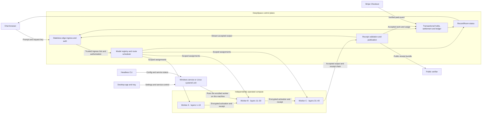
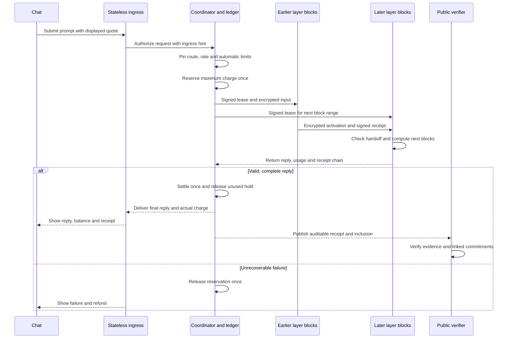

# NeuroGrid architecture

**Implementation status as of November 24, 2026.** The repository's Granite candidate runs four BF16 CPU partitions with reference recomputation. The diagrams describe the target attested architecture. The [release test evidence](docs/granite-beta-results.md) and [handoff](docs/next-feature.md) track open gates. [Watch the animated architecture walkthrough](docs/neurogrid-next-architecture.mp4).

## Target architecture

NeuroGrid routes inference requests to independently operated compute workers. DeepSpace handles web hosting, authentication, read-only status updates, and the stateless request ingress. The coordinator manages assignments and the credit ledger. Workers produce the inference result and the evidence attached to it. An independent verifier can validate the evidence without running inference.

The three compute boxes illustrate one route. A node can host zero or more adjoining blocks within its resources. A route can use one machine or several, and a different job can use a different route. The contributor apps shown manage one example machine. The compute and control plane paths have separate failure and scaling concerns.

## Model and execution

- **Paid default.** The target is pinned IBM Granite 4.2 8B, a dense Granite decoder with 40 layers, hidden width 4,096, and a 100,352-token vocabulary. Package four 10-layer blocks. Put the embeddings in the first block and the final normalization and vocabulary head in the last. Pin artifact hashes, tokenizer and chat template, numerical format, and sampling policy in the manifest. Each worker loads the ranges it advertises. Benchmark memory, quality, and latency before enabling a quantized variant.
- **TwIL-8B research.** TwIL-8B uses the same base architecture and has its own weights and model manifest. Its published license limits use to non-commercial research and education. Paid deployment requires commercial permission. The IBM Granite base is Apache-2.0. [Granite model card](https://huggingface.co/ibm-granite/granite-4.2-8b) · [Granite configuration](https://huggingface.co/ibm-granite/granite-4.2-8b/blob/main/config.json) · [TwIL model card](https://huggingface.co/webAI-Official/TwIL-8B) · [TwIL license](https://huggingface.co/webAI-Official/TwIL-8B/blob/main/LICENSE.md)
- **Inference.** Tokenize with the selected model’s chat template. The server picks automatic context and output limits. The first pass processes the prompt and initializes the KV cache. Later passes run the next token against cache state retained on the assigned workers. Send authenticated, encrypted binary activations stage to stage. A trusted regional relay can carry encrypted traffic where direct connectivity is unavailable. The coordinator accepts worker output with valid evidence. The operator’s current full reference verifier belongs in offline regression testing.
- **Placement and concurrency.** Admit many independent requests subject to bounded queues and worker capacity. Use a trusted ingress hint such as `request.cf.colo` to shortlist regional workers. Rank complete routes by fresh ingress-to-worker and peer link measurements, warm blocks, queue delay, compute, and failure history. The colo identifies the incoming data center. Treat it as a hint and measure actual serving paths. Co-locate contiguous blocks or select a whole-model worker when that is faster. Keep leases and cache affinity stable until failure or completion. [Cloudflare request metadata](https://developers.cloudflare.com/workers/runtime-apis/request/) · [Petals research](https://arxiv.org/abs/2312.08361)

## Verification and trust

The initial release uses **hardware-backed remote attestation**. The signed worker runtime checks the pinned model and signs receipts that bind the job, assignment, block range, sequence, metered work, and input/output and cache state commitments. The next stage checks the handoff before using it. Any observer can check the published evidence, receipt chain, and inclusion with a public verifier and no model execution. A requester can match their reply to its receipt. Public receipts expose commitments and exclude prompt text, activation data, and replies. This guarantee relies on the approved runtime and hardware root of trust. [IETF remote attestation architecture](https://www.rfc-editor.org/rfc/rfc9334) · [NVIDIA attestation](https://docs.nvidia.com/confidential-computing/containers/dev/attestation)

A later **mathematical proof** mode would bind the same statement to the actual numerical operations and verify it independently of hardware attestation. Gate it on measured proving throughput and interactive latency. The scheduler and payment authority remain operator-controlled. Published, independently observed ledger checkpoints make later history changes auditable relative to known checkpoints. [zkLLM research](https://arxiv.org/abs/2404.16109)

## Contributor clients and startup

The target desktop app offers a persistent **Settings → Compute limits** screen and tray entry, saves changes before the first compute run, restores them on reopen, and shows effective limits and node status. Its login-only tray UI can supervise a separately installed background worker. The headless CLI exposes the same saved settings, status, and controls through a validated local configuration and authenticated service interface.

The Windows Service Control Manager and Linux systemd supervise enrolled worker processes at boot. They reuse settings, identity, and model cache before a user signs in, then reconnect when networking is ready. An owner can limit CPU, duty cycle, GPU memory, concurrent sessions, and layer capacity, and retrieve those limits in either interface. Settings and ownership apply whether a process is started at boot or manually. The [handoff](docs/next-feature.md#4-give-contributors-durable-controls) specifies persistence, migration, service recovery, and OS-specific tests. [Windows service startup](https://learn.microsoft.com/en-us/windows/win32/services/service-startup) · [systemd service documentation](https://www.freedesktop.org/software/systemd/man/latest/systemd.service.html)

## Credits and accounting

A confirmed purchase issues prepaid service credits. The app quotes and holds a maximum automatically. The launch target is **2 credits for a completed Quick reply**, such as a genuine 8B answer of Paris to “What is the capital of France?” The locked quote covers retries. A completed job releases unused credit, transfers a portion of the charge to workers, and retires the platform share. An unsuccessful job returns the hold in full under the launch policy. Use one transaction for balances, job settlement state, and ledger entries. Keep processor cash, work credits, fiat expenses, and reversals distinct. [Implementation and pricing details](docs/next-feature.md#3-make-each-credit-cover-more-compute) · [Stripe Checkout fulfillment](https://docs.stripe.com/checkout/fulfillment)

## Granite candidate

| Area | Implemented today |
| --- | --- |
| Web and control | React, TypeScript, Hono, DeepSpace auth and RecordRoom, and one SQLite-backed coordinator with a bounded concurrent queue |
| Model | Pinned IBM Granite 4.2 8B, four ten-layer BF16 CPU partitions, worker-local KV caches, and an operator reference |
| Chat | Completed turns provide context. The verifier formats inputs with the pinned tokenizer before the coordinator quotes and reserves. |
| Worker selection | The coordinator pins a complete route using fresh relay-path RTT, verified execution metrics, queue load, failure history, and a Cloudflare location hint. |
| Contributor settings | Desktop and CLI share a durable profile. SCM and Linux beta systemd installers provision separate service identities and caches. Unattended restart tests remain pending. |
| Credits | The versioned ledger preserves existing balances and issues new credits after a paid Checkout event. Settlement distributes the reward share and retires the platform share. |
| Trust | The operator recomputes the numerical result. The public ledger verifies accounting and the integrity of recorded digests. Hardware-backed receipt validation remains a production gate. |

Use the [README and test runbook](README.md), [installer instructions](packaging/INSTALL.md), and [coordinator source](src/neurogrid/coordinator.ts) to reproduce the candidate. Use the [required test gates](docs/next-feature.md#8-mandatory-implementation-and-release-tests) to assess release readiness.
