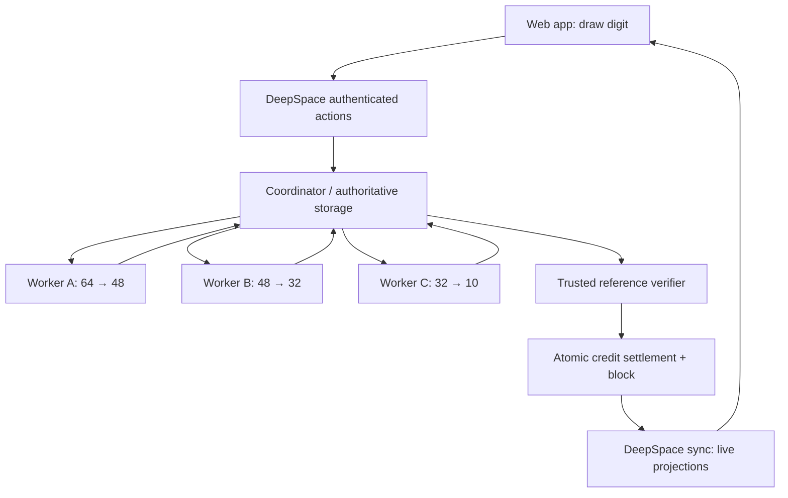
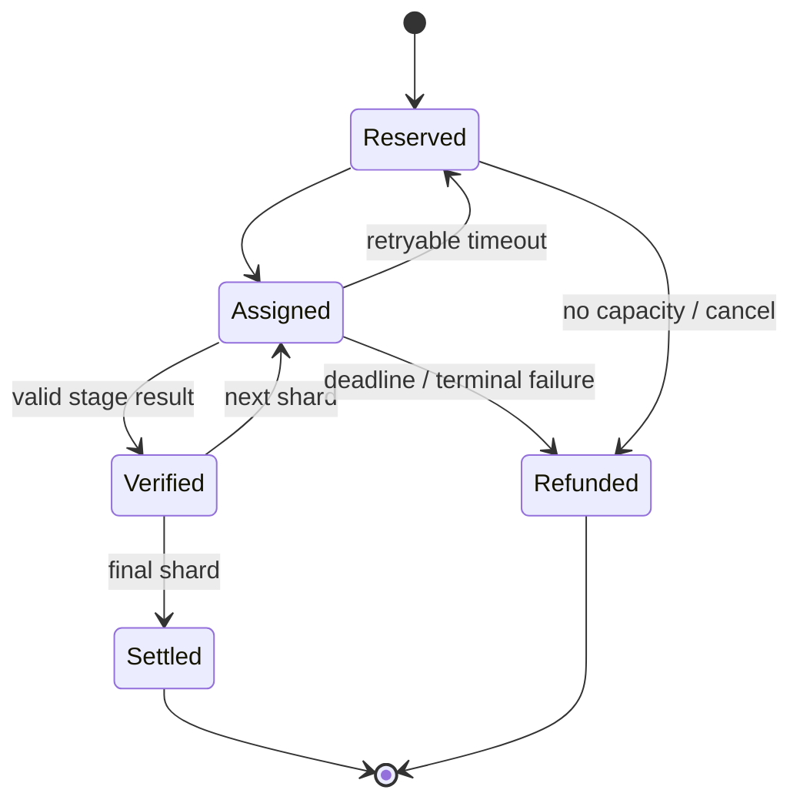

# ShardNet — Architecture and protocol

## 1. System boundaries

ShardNet demonstrates cooperative neural-network inference with credit settlement. DeepSpace is the trusted control plane. Browser workers are the compute plane. The ledger is an append-only hash-linked audit log, not consensus. Independent computers are not required for reviewer onboarding, but real separate browser sessions must be supported; local multi-worker demo is a simulation of distribution, not hardware decentralization.



Workers do not directly relay tensors to one another in the MVP: coordinator validates each result and routes the next stage. This trades latency and decentralization for simple authentication, verification, fault handling and deployability. No raw tensors or images in public projections.

## 2. Concrete model and reproducibility

Use scikit-learn's built-in digits dataset, 1,797 labeled 8×8 grayscale samples (pixel intensities 0–16). This is **not MNIST**. Ref: https://scikit-learn.org/stable/modules/generated/sklearn.datasets.load_digits.html. A small MLP avoids external model downloads, heavy runtime dependencies, autoregressive KV caches, or GPUs.

- Train offline with Python and scikit-learn `MLPClassifier(hidden_layer_sizes=(48,32), activation="relu", solver="adam", random_state=42, max_iter=500)`. Use a stratified 80/20 split with random_state=42. Normalize pixels by 16, train on training set only. Report actual held-out accuracy, confusion matrix optional. Target ≥90% held-out accuracy; do not invent metrics or repeatedly tune against holdout. Record package versions and weight provenance.
- Export weight matrices and biases from `coefs_` and `intercepts_` as JSON, with input-major layout W[input][output], numeric finite values, three immutable shard assets, model version and SHA-256 of exact artifact bytes.
- Hidden layers: `y[j] = max(0, b[j] + sum_i x[i]*W[i][j])`. Final layer produces logits (no ReLU). Use numerically stable softmax subtracting maximum logit; prediction is argmax. Use JS Number/float64 consistently for worker and reference; compare against sklearn predict_proba on held-out sample fixtures with tolerance.
- Partitions: (64×48 + 48), (48×32 + 32), (32×10 + 10) = 5,018 parameters; only 4,928 multiply-accumulate operations per inference (excluding activation/bias/softmax). This model is intentionally tiny and not faster distributed; demonstrate architecture, not a speedup claim.
- Canvas: draw white on black at high resolution; crop bounding box, preserve aspect ratio, center on 8×8 with padding, downsample, normalize to [0,1], preview final 8×8 input. Test orientation against dataset samples; reject blank canvas. Include held-out sample fixtures so reviewers can test reliable inputs.
- Each volunteer downloads only its assigned shard, validates manifest hash, and computes using an isolated Web Worker. Reference evaluator loads all shards on server (small enough for Worker bundle). Do not claim shard confidentiality: public assets may be downloaded.

## 3. Logical data model

Use scaffold's actual collection/schema APIs. Names below are application concepts, not invented SDK APIs.

| Entity | Essential fields |
|---|---|
| Account | userId, availableCredits, reservedCredits |
| Node | nodeId, ownerId, partition, modelHash, lastSeenAt, activeLeaseId, reliability |
| Job | jobId, requesterId, modelHash, state, stageIndex, input, activation, deadline, reservedPrice |
| Lease | leaseId, jobId, stageIndex, nodeId, ownerId, issuedAt, expiresAt, state |
| Receipt | jobId, stageIndex, leaseId, nodeId, inputHash, outputHash, verifiedAt, reward |
| Block | height, previousHash, timestamp, type, jobId, receiptHashes, transfers, hash |
| Treasury | availableCredits, pendingAvailabilityBudget |

Authoritative records live in one transaction-capable coordinator. DeepSpace sync collections expose bounded, permissioned projections, not authoritative writable financial state. Public projections show anonymized node labels, stage/status, timestamps, amounts and hashes only. Jobs and raw activations limited to requester, currently assigned worker and server; expire/delete raw data after completion when practical. Ledger hashes are not encryption.

## 4. Worker lifecycle and scheduling

Worker explicitly clicks Join Network, selects or accepts a suggested partition, downloads that versioned shard, creates Web Worker, and registers through authenticated action. Stop button and visibility/connection errors stop accepting new work. Heartbeat every 10s while enabled; online iff seen within 30s (server time). One lease per active node, bounded nodes per account. Browser timers can be throttled; never promise background uptime.

Prefer least-covered partition for new volunteers (minimum online count; tie by partition index). For a job stage, eligible means exact model hash/partition, online, authenticated, no active lease. Choose least recently assigned, tie by node ID; transactional claim. This rotating policy is fair within eligible same-capacity nodes; not Sybil resistant. Record assignment timestamps. Optional P1 weight by measured throughput and reliability only after baseline is tested.

Stage uses a 15s lease plus overall job deadline 90s (configurable). Worker polls/receives private assignment via supported SDK primitives, receives only required input vector, returns activation and opaque lease ID. Server checks owner, job, stage, lease expiry/state, model version, dimensions, finite values and quotas. On timeout release/reassign once if suitable node available; otherwise cancel/refund. Do not hold indefinitely waiting for a shard. Use supported Durable Object alarm / jobs or transactional expiry evaluation on requests; make expiry visible and test eventual cleanup even without a browser tab.



Stages remain sequential within a request. Multiple requests may pipeline concurrently on different free nodes; never reuse activations between unrelated jobs. Final result becomes visible after successful settlement.

## 5. Verification

Server recomputes the expected shard output for the exact input and bundled weights independently of worker. For each element require `abs(actual - expected) <= 1e-8 + 1e-6*abs(expected)`. Reject NaN, Infinity, wrong lengths, invalid leases and incorrect outputs. Continue with canonical reference output (or canonicalize accepted output) to prevent tolerances accumulating. Hash canonical serialized input/output and model version for receipt. Use server-side authenticated identity; worker cannot select its reward.

This verifies output agreement under a trusted coordinator, **not proof of execution**. Worker could obtain a known correct output without independently computing it. Identical inputs might be cached; no guarantee of unique physical work. The full reference recomputation roughly duplicates arithmetic and defeats cost savings here. Future approaches include probabilistic audits, independent validators and verifiable inference, all out of scope.

## 6. Credit economy and ledger

All units are integer demo compute credits, nonredeemable and nontransferable except protocol settlement. No fiat value. Genesis treasury 100,000 credits; allocate 100 to each authenticated demo account exactly once from treasury, with account creation block or transaction. Enforce a finite registration/demo budget; no unbounded faucet. No ongoing minting. Total equals treasury + available account balances + reservations. Use server-side maximums and checked integer range.

Fixed request price: 10 credits. P0 split per successfully settled job: three shard rewards of 3 credits each and 1 treasury credit. Workers may earn multiple stage rewards if they host more than one shard in distinct authorized sessions; requester may be a worker, which is allowed and should be disclosed. If no job finishes, no stage reward in prototype (simple all-or-nothing settlement). Verification cost is covered by simulated treasury allocation; this is not a profitable business simulation.

1. Job creation and reservation atomically move 10 available credits into held funds after balance/eligibility checks.
2. Verified stage writes one immutable receipt keyed by job+stage (duplicate submissions idempotent or rejected).
3. Final successful settlement checks all three receipts and current state, releases reserve, credits three owners and treasury, appends one settlement block, marks job settled, updates head in a single transaction. No client awaits between read/check/write.
4. Terminal failure atomically returns reservation exactly once, marks refunded, appends refund audit event; no reward. Duplicate requests must not alter balances.

### Optional availability incentives (P1)

If implemented, change price split explicitly to 3+3+2 compute, 1 availability pool, 1 treasury (or another documented integer split). Availability pool is escrowed inside treasury and distributed in bounded daily epochs after actual demand funds it. Credit totals remain conserved. Score each eligible node by capped verified online duration × scarcity factor × challenge pass ratio. Scarcity factor = clamp(target online providers / max(1, online count), 0.5, 3), target 2 per partition; time-average or sample at fixed epochs, not client claims. Use a bounded random deterministic-input challenge evaluated by reference verifier; a heartbeat alone earns no reward. Cap per account, distribute integer rewards proportional to scores with deterministic remainder handling, append distribution block. If no revenue, no bonuses (unless explicitly spending limited genesis subsidy); unused funds remain pooled. Clearly label this as experimental, not Sybil-proof.

### Ledger representation

Server-authoritative sequence, explicit genesis (height 0, previousHash 64 zeros). Store canonical JSON representation with deterministic key order, fixed schema/order of transfers and receipts, UTF-8 bytes, SHA-256. Hash all block fields except hash itself; link to previous hash. Keep hashes lowercase hex. Include version and event type. Reservation/grant/refund/settlement and optional availability payout events must be auditable; record balance changes with signed integer deltas including reserves, treasury and pool. For demo, a block per state-changing financial event is fine; no empty mining blocks.

Chain verification checks genesis, consecutive height/link, recalculated hash, event uniqueness, transfer sums and nonnegative replayed balances. Export ledger JSON and show Verify Ledger button. A hash chain detects tampering against a known head; coordinator could rewrite entire history. No distributed consensus or fork resolution. If hashing async before storage commit, use compare-and-swap on expected head/state/version with retry and revalidation, or a supported atomic transaction design. Never assume individual SDK writes form one transaction.

## 7. Action contracts (conceptual)

| Action | Input | Output / authority |
|---|---|---|
| registerNode | desiredPartition, modelHash | nodeId; session-derived owner |
| heartbeat | nodeId | server timestamp/status; owner only |
| leaveNode | nodeId | offline; release/retry active lease |
| createJob | 64 normalized pixels, requestId | jobId and reserved price; dedupe per requester |
| claimWork | nodeId | eligible lease + required input, or none |
| submitStage | leaseId, output vector | verified/rejected/stale status; server computes result |
| cancelJob | jobId | terminal refund only if allowed; requester owns job |
| verifyLedger | none | server or local export verification outcome |

Map these contracts to actual DeepSpace authenticated server actions or worker routes after inspecting SDK docs. Use server rate limits (e.g. max 2 concurrent jobs/account, 10 requests/min/account, 1 active lease/node, bounded registration). Idempotency keys scoped to authenticated identity. No generic user-controlled write operation for financial or worker assignment records. Protocol errors never leak stack traces or raw inputs.

## 8. UI and demonstration

- Landing: concise explanation, live URL, sign-in, sample digit.
- Playground: canvas, sample buttons, normalized 8×8 preview, price/balance, Run inference. Stage cards show waiting/running/verified, assigned node alias and elapsed time; final digit and confidence chart. Show empty/insufficient-capacity/error/refund states.
- Network: explicit contribute toggle, partition capacity counts, last heartbeat, compute receipts, earnings. No invented online participants. Local demo mode starts three isolated Web Workers in one session, marked simulated network; same coordinator and verification rules.
- Ledger: height, hash, previous hash, event, credit transfers and receipt references; verify button and export. Explain trusted coordinator.
- Responsive UI, keyboard-accessible controls, helpful errors, loading and empty states. Never require a Chrome extension.

## 9. Suggested modules

Adapt to scaffold instead of overriding its deployment structure:

```text
src/
  pages/                 # scaffold route conventions
  components/            # canvas, pipeline, network, explorer
  model/                 # manifest, preprocess, shard math, reference
  compute/worker.ts      # browser Web Worker
  schemas/               # permissioned sync projections
  server/                # actions, coordinator, validation, storage
  protocol/              # types, state transitions, accounting, hashing
public/model/            # immutable shard JSON
scripts/train_model.py
tests/                   # unit, integration, end-to-end
README.md
AGENTS.md
architecture.md
```

## 10. Verification matrix

| Test | Expected |
|---|---|
| Held-out fixtures | Sharded result matches full sklearn probabilities within tolerance |
| Wrong output or NaN | Reject, no credit reward |
| Three different worker sessions / two browsers | Correct ordered activations; truthful node identity |
| Worker disconnects | Lease expires; retry or refund, no duplicate rewards |
| Duplicate/stale submit | No repeat stage advance or balance changes |
| Concurrent final submissions | Exactly one settlement and unique chain head |
| Double spend / insufficient balance | Reject before assignment |
| Replayed ledger | Conserves supply, agrees with stored balances |
| Modified block | Verify failure with first invalid height |
| Authorization | Nonowners cannot read private tensors or mutate balances |
| Reload/deploy | Persisted balances, records, and working critical flow |

Measure actual inference accuracy and timing separately from network round-trip time. Compare sharded vs local latency with at least 10 sample requests if time permits; do not claim distributed speedups. Record failures and fixes.

## 11. Deployment and sources

- DeepSpace docs: https://docs.deep.space/ ; platform auth, SQLite-backed sync, permissions and hosting are required native primitives.
- Integration catalog: https://docs.deep.space/guides/external-apis ; test provider endpoints only when justified and consented. See AGENTS.md.
- Model inspiration/data: https://scikit-learn.org/stable/modules/generated/sklearn.datasets.load_digits.html ; https://scikit-learn.org/stable/modules/generated/sklearn.neural_network.MLPClassifier.html
- Prior art: Petals, NeurIPS 2023, https://arxiv.org/abs/2312.08361 ; distributed partition scheduling and fault tolerance at far larger scale. Do not claim novelty.
- Deploy with `npx deepspace deploy`; verify actual live URL in a clean browser and record it in README. Keep a reproducible setup and small model artifacts under version control.
